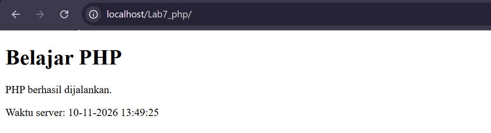
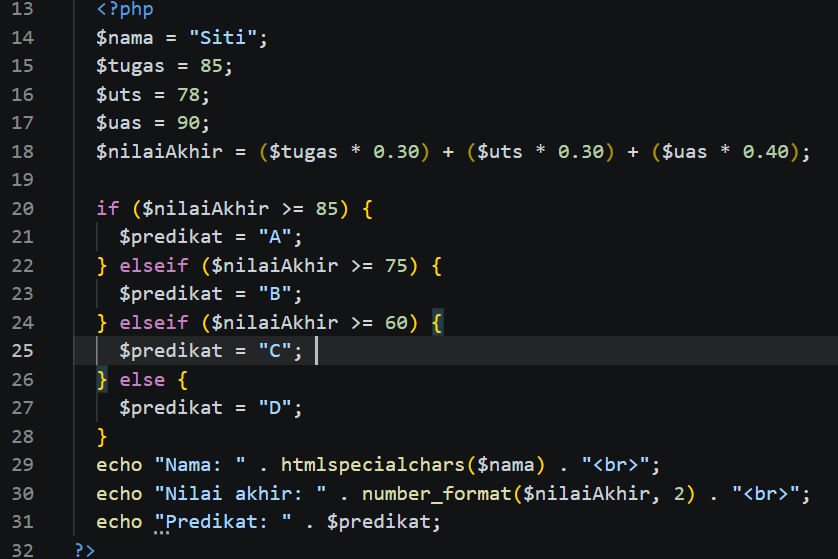
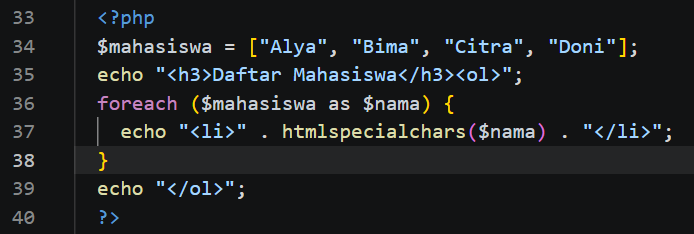
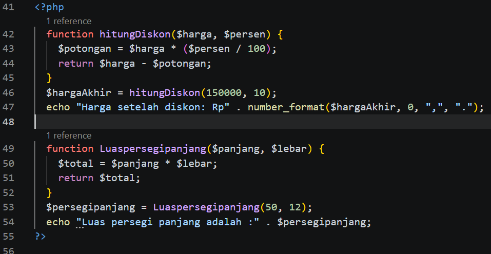
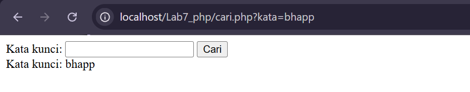
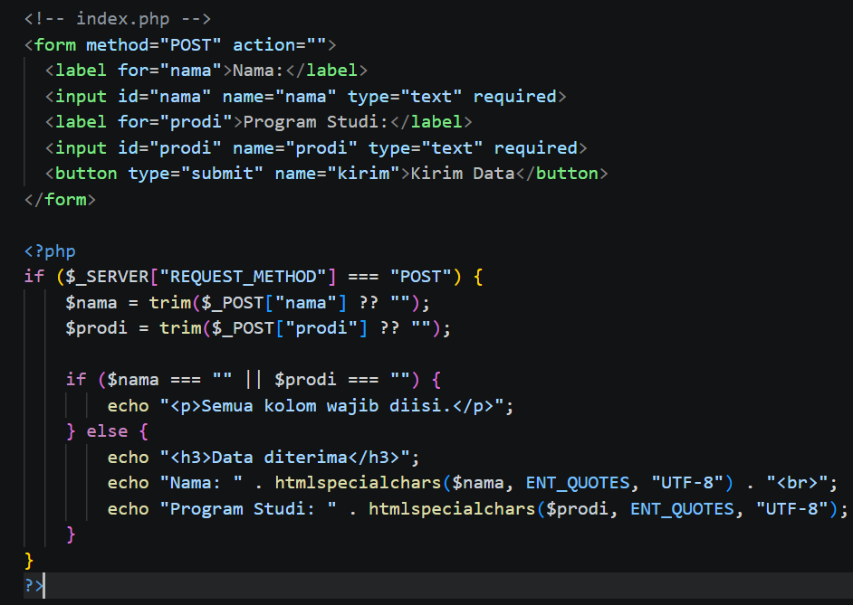
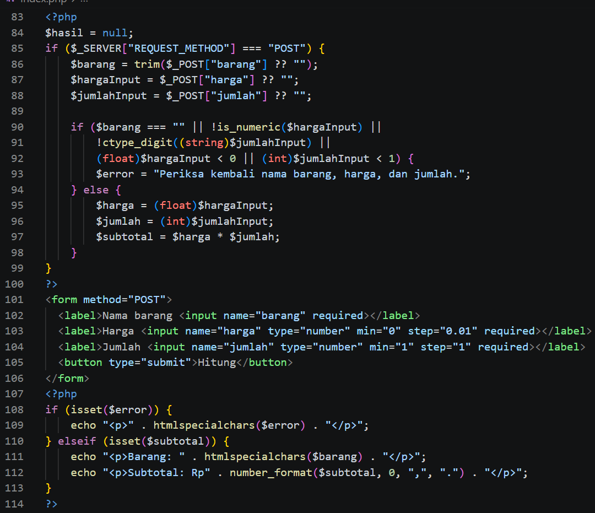
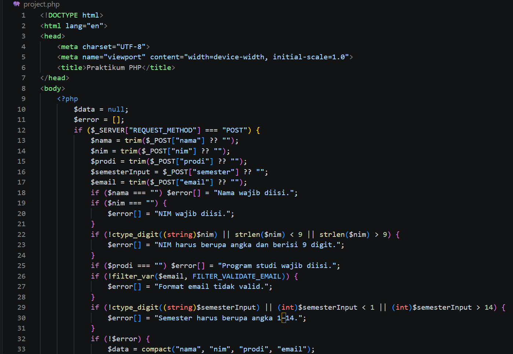

# Praktikum 7: Pemrograman Server-Side dengan PHP - Lab7Web_PHP

Nama : Fuad Muhammad Adfal  
NIM : 312510262  
Kelas : I251A 
Mata Kuliah : Pemrograman Web

## E. Langkah Kerja Praktikum

### Latihan 1: Menjalankan PHP
Membuat `index.php` yang menampilkan teks dan waktu server dengan `echo` dan `date("d-m-Y H:i:s")`. File dijalankan lewat web server lokal (XAMPP) di `http://localhost/lab7_php/`, bukan dengan klik ganda. Browser hanya menampilkan output HTML, sedangkan kode PHP-nya tidak terlihat.

  
  

### Latihan 2: Variabel, Operator, dan Percabangan
Menghitung nilai akhir dari tiga komponen dengan bobot **30% tugas + 30% UTS + 40% UAS**, lalu menentukan predikat memakai `if - elseif - else` (A ≥ 85, B ≥ 75, C ≥ 60, selain itu D). Nilai diuji dengan beberapa kombinasi:

| Tugas | UTS | UAS | Nilai Akhir | Predikat |
|-------|-----|-----|-------------|----------|
| 85 | 78 | 90 | 84.90 | B |
| 70 | 88 | 74 | 77.00 | B |
| 80 | 65 | 71 | 71.90 | C |

  
  
  
  
  
  

### Latihan 3: Perulangan dan Array
Menyimpan daftar nama mahasiswa dalam array lalu menampilkannya sebagai daftar bernomor dengan `foreach`. Awalnya terdapat empat nama, kemudian ditambah tiga nama (Abdul, Gofar, Bhapp) sehingga menjadi tujuh.

  
  
  
  

### Latihan 4: Membuat Function
Membuat function `hitungDiskon($harga, $persen)` yang menghitung harga setelah diskon dan mengembalikannya dengan `return`. Harga 150.000 dengan diskon 10% menjadi **Rp135.000**. Sebagai tambahan, dibuat function `luasPersegiPanjang($panjang, $lebar)`. Dengan panjang 30 dan lebar 12 hasilnya **360**.

  
  

### Latihan 5: Memproses Form dengan GET
Membuat `cari.php` berisi form dengan `method="GET"`. Kata kunci diambil lewat `$_GET["kata"]`, dibersihkan dengan `trim()`, lalu ditampilkan dengan `htmlspecialchars()`. Setelah form dikirim, URL berubah menjadi `cari.php?kata=sepedah`. Artinya data GET terlihat di URL, sehingga tidak cocok untuk data sensitif seperti kata sandi.

  
  

### Latihan 6: Memproses Form dengan POST
Membuat form nama dan program studi dengan `method="POST"`. Data diambil dari `$_POST`, divalidasi agar tidak kosong, dan ditampilkan dengan `htmlspecialchars()`. Skenario pengujian:

| Skenario | Hasil |
|----------|-------|
| Kolom dikosongkan | Browser menolak dengan pesan "Please fill out this field" (atribut `required`) |
| Data lengkap (fuad, Teknik Informatika) | Muncul "Data diterima" beserta datanya |
| Input berisi tanda kutip dan tag HTML (`"fuad"` dan `<h1>Teknik Informatika
`) | Ditampilkan apa adanya sebagai teks, tag tidak dieksekusi browser |

  
  

### Latihan 7: Pengolahan Data Sederhana
Membuat form nama barang, harga, dan jumlah. PHP memvalidasi input (`is_numeric`, `ctype_digit`, harga tidak negatif, jumlah minimal 1) lalu menghitung subtotal dan menampilkannya dalam format rupiah. Hasil pengujian:

| Input | Hasil |
|-------|-------|
| coklat, harga 10.000, jumlah 10 | Subtotal Rp30.000 |
| Jumlah 0 | Ditolak browser ("Value must be greater than or equal to 1") |
| Jumlah -2 | Ditolak browser dengan pesan yang sama |
| coklat, harga `2.000`, jumlah 1 | Subtotal Rp2 |

Pada pengujian terakhir, `2.000` dibaca PHP sebagai angka desimal 2,0 (bukan dua ribu), sehingga subtotalnya Rp2. Harga sebaiknya diketik tanpa pemisah ribuan, misalnya `2000`.

  
  
  
  
  

## F. Mini Project: Aplikasi Formulir Data Mahasiswa

Aplikasi satu halaman (`index.php`) yang menerima data mahasiswa lewat form `POST`, memvalidasinya di sisi server, lalu menampilkan ringkasan data.

- **Form:** nama, NIM, program studi, semester, dan email.
- **Validasi server-side:**
  - nama, NIM, dan program studi wajib diisi;
  - email harus valid, diperiksa dengan `filter_var(..., FILTER_VALIDATE_EMAIL)`;
  - semester harus bilangan bulat 1-14, diperiksa dengan `ctype_digit()` dan rentang nilai.
- **Pesan error:** semua kesalahan dikumpulkan dalam array `$error`, lalu ditampilkan satu per satu dengan `foreach` dan `htmlspecialchars()`.
- **Hasil:** jika tidak ada error, data digabung dengan `compact()` dan ditampilkan sebagai ringkasan "Data Mahasiswa". Bagian pemrosesan (PHP di atas) dipisahkan dari bagian tampilan (HTML dan output).

Pengujian:

| Kasus | Input | Hasil |
|-------|-------|-------|
| Tidak valid | Semua kolom kosong | Lima pesan error: nama, NIM, prodi, email, dan semester |
| Tidak valid | NIM 8 digit (`12345678`) | "NIM harus berupa angka dan berisi 9 digit." |
| Valid | Data lengkap (Raihan, NIM 312510206, Teknik Informatika, semester 3) | Ringkasan Data Mahasiswa tampil |
| Valid | NIM 9 digit (`123456789`) | Ringkasan Data Mahasiswa tampil |

  
  
  
  
  

## G. Pertanyaan Evaluasi

1. **Apa perbedaan pemrosesan client-side dan server-side?**
   * *Jawaban:* Client-side diproses di browser pengguna, contohnya HTML, CSS, dan JavaScript. Server-side diproses di server, contohnya PHP: menerima permintaan, memproses input, menjalankan aturan aplikasi, lalu mengirim respons kembali. Browser hanya menerima hasil output (misalnya HTML), bukan kode PHP mentah.

2. **Mengapa file PHP harus dijalankan melalui web server?**
   * *Jawaban:* PHP membutuhkan interpreter yang dijalankan oleh web server (Apache pada XAMPP). Jika file dibuka dengan klik ganda (`file://`), browser tidak bisa menjalankan PHP sehingga kodenya tampil sebagai teks atau tidak berfungsi. Melalui `http://localhost/...`, server mengeksekusi PHP lebih dulu lalu mengirimkan hasil HTML ke browser.

3. **Apa fungsi tanda `$` pada variabel PHP?**
   * *Jawaban:* Tanda `$` adalah penanda bahwa sebuah nama adalah variabel, misalnya `$nama = "Andi";`. Nama variabel setelahnya bersifat *case-sensitive*, jadi `$nama` dan `$Nama` adalah dua variabel berbeda.

4. **Apa perbedaan metode GET dan POST?**
   * *Jawaban:*
     * **GET** mengirim data lewat URL (query string), misalnya `cari.php?kata=sepedah`. Data terlihat di URL, bisa di-bookmark, dan panjangnya terbatas, sehingga cocok untuk pencarian atau data tidak sensitif.
     * **POST** mengirim data di body request sehingga tidak tampil di URL (seperti pada form `index.php`). Cocok untuk data yang lebih banyak atau sensitif dan untuk proses yang mengubah data. POST tidak otomatis terenkripsi, jadi untuk data sensitif tetap perlu HTTPS.

5. **Mengapa input pengguna perlu divalidasi di sisi server?**
   * *Jawaban:* Validasi di browser (atribut `required`, JavaScript) mudah dilewati, misalnya lewat Developer Tools atau mengirim request langsung. Server adalah pemeriksaan terakhir sebelum data diproses, sehingga validasi di server menjaga data tetap benar dan aplikasi aman. Validasi HTML hanya membantu kenyamanan pengguna.

6. **Apa fungsi `htmlspecialchars()` ketika menampilkan data dari form?**
   * *Jawaban:* Fungsi ini mengubah karakter khusus HTML (`<`, `>`, `&`, `"`, `'`) menjadi entitas HTML. Akibatnya input seperti `<h1>Teknik Informatika
` tampil sebagai teks biasa dan tidak dieksekusi browser. Ini mencegah serangan XSS (*Cross-Site Scripting*), seperti terlihat pada pengujian Latihan 6.

7. **Apa manfaat penggunaan function dalam program PHP?**
   * *Jawaban:* Function membuat kode dapat dipakai ulang tanpa menulis ulang, lebih rapi dan mudah dibaca, serta mudah dirawat karena perubahan cukup dilakukan di satu tempat. Contohnya `hitungDiskon()`, `luasPersegiPanjang()`, dan `formatRupiah()` yang bisa dipanggil berkali-kali dengan nilai berbeda.